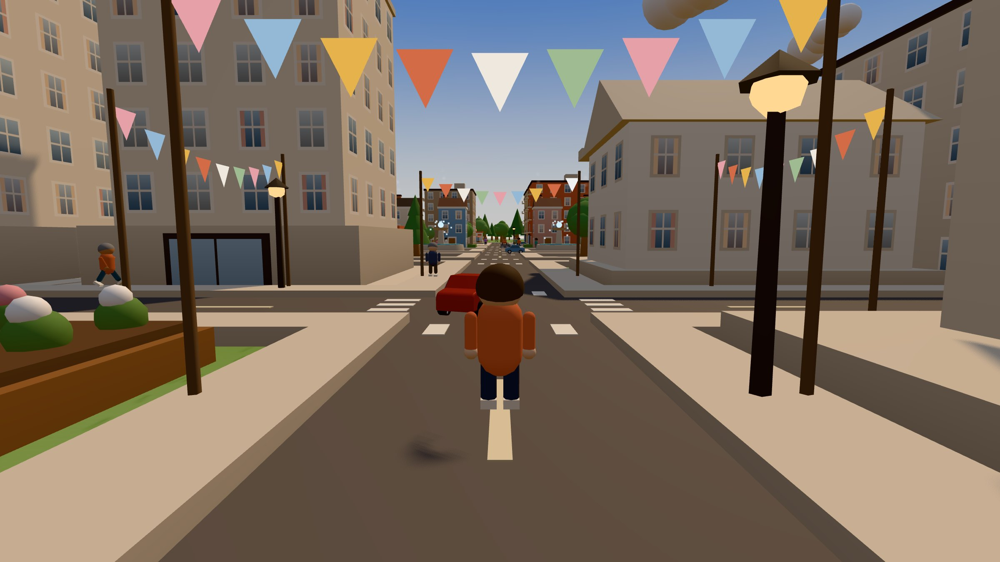

# Contextville

A cozy 3D city that grows with the tokens Claude writes for you. Use Claude Code as normal, and every token lands in your city as money to build with.


## Install

In Claude Code, run:

```
/plugin install contextville --marketplace hollowbit-dev/contextville
```

Type `y` to add the marketplace, then choose a scope. The next time you start Claude Code, your city opens in your browser.

You need [Node.js](https://nodejs.org) 18 or newer. To open the city at any time, run `/contextville:open`.

## What you can do

- **Build a city** with homes, shops, parks, civic buildings and wonders.
- **Paint the land** with beach, forest, meadow, snow, paving and more, and choose from seven kinds of road.
- **Become a person.** Press `P` to walk the streets, go inside buildings, buy food and talk to whoever is at the counter.
- **Fly between islands.** Finish an island, build an Airport, and buy the next one. There are five, each bigger than the last.
- **Watch it live.** Traffic, residents, weather, seasons, day and night, generative music and a light that shows when Claude is working or done.

| | |
|---|---|
|  |  |


## Controls

| Key | Action |
|---|---|
| Drag | Move the view |
| Right-drag or `Q` `E` | Turn |
| Scroll | Zoom |
| `1` to `7` | Open a build menu |
| `R` | Rotate |
| `X` | Sell |
| `N` | Show what homes need |
| `Cmd/Ctrl + Z` | Undo |
| `P` | Walk around |
| `WASD`, `Shift`, `Space` | Walk, run, jump |
| `E` | Enter or use what's in front of you |
| `V` | First person |

## Privacy

Contextville runs entirely on your computer and makes no network requests. Its local server reads token counts, session titles and project folder names from your Claude Code data, and only your own browser can reach it. Your city is saved in `~/.contextville`.

## Turn off auto-open

Open **Help** in the game and untick **Open this city when Claude Code starts**. To remove it completely, run `/plugin uninstall contextville`.

## Notes

Made and tested on macOS. Windows and Linux should work but have not been tested yet.

This is an unofficial fan project and is not affiliated with or endorsed by Anthropic.

MIT licensed. Uses [three.js](https://threejs.org) (MIT).
